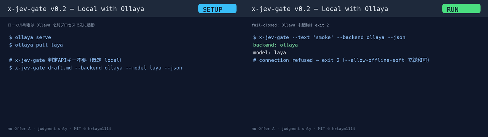

# x-jev-gate

日本語: [README.md](README.md)

**A CLI for evaluating X drafts that asks TypeSafe Jev (System One) how likely they are to be safe to publish.**

A small public gate for X drafts: Layer A hard-blocks secret-looking strings locally, then Layer B asks [TypeSafe Jev](https://docs.typesafe.ai) defined Noul questions and exits non-zero when scores miss thresholds.

- Jev **writes nothing, posts nothing, publishes nothing** — judgment only.
- No long LLM critique. Cheap, fast, explainable Noul scores.
- Sibling of [`grok-bot-jev`](https://github.com/Bodila51/grok-bot-jev) (Grok Bot router). This package is **post-gate specialized**.

## How to use (video)

An approximately 54-second walkthrough (Japanese UI / commands remain in English).

GitHub’s in-repository preview sometimes cannot play large MP4 files, so the **page uses a GIF**, while the **full MP4 is available in the Release**.


**[▶ Open the full MP4 (1080p, silent)](https://github.com/hrtaym1114-github/x-jev-gate/releases/download/v0.1.0/x-jev-gate-howto.mp4)**  
Storyboard: [strip](docs/media/x-jev-gate-howto-strip.png) · [Release v0.1.0](https://github.com/hrtaym1114-github/x-jev-gate/releases/tag/v0.1.0)

### 4 steps

1. **Install** — `pip install git+https://github.com/hrtaym1114-github/x-jev-gate.git`
2. **Choose an evaluation backend**
   - **Cloud (default)** — `export TYPESAFE_API_KEY=...` (shell / secret manager only. Never commit it)
   - **Local (Ollaya)** — Use `ollaya serve` + `ollaya pull laya` with [ollaya.dev](https://ollaya.dev/) (no key required; defaults to `local`). See [Local with Ollaya](#local-with-ollaya) for details
3. **Run** — `x-jev-gate --text '...'` or `--backend ollaya`
4. **Result** — **PASS** (exit 0) / **BLOCK** (exit 1) / evaluation unavailable (exit **2**, fail closed)

Smoke test without a key: `x-jev-gate --dry-run-offline --text 'smoke test body'`  
Note: This does not post automatically. Evaluation only. There is no Offer A or sales link.

## What is Jev?

Jev (TypeSafe System One) is a low-cost judgment layer that returns probability scores for predefined yes/no (Noul) questions. Instead of asking a generative model for a lengthy critique, it returns numerical scores for questions such as “Will this resonate with the persona?”, “Does it have a hook?”, and “Is it safe to publish?”, then uses thresholds to gate the draft.

## Install

```bash
# from GitHub (recommended for users)
pip install git+https://github.com/hrtaym1114-github/x-jev-gate.git

# editable (recommended while developing)
pip install -e ".[dev]"
# or with uv
uv pip install -e ".[dev]"
```

Requires Python ≥ 3.10 and a TypeSafe API key for cloud judgment.

```bash
export TYPESAFE_API_KEY=...   # secret manager / shell env only
# このツールは vault の秘密ファイルを読みません
```

Never commit the key. The CLI never logs `TYPESAFE_API_KEY`.

## Local with Ollaya

For laptops on isolated networks and environments without API keys, you can connect to local System One running on [Ollaya](https://ollaya.dev/) (unaffiliated).  
x-jev-gate **does not bundle or automatically start Ollaya**. Start it as a separate process, then use `--backend ollaya`.

[](docs/media/x-jev-gate-ollaya-howto.gif)

- 🎞️ [GIF](docs/media/x-jev-gate-ollaya-howto.gif) · Release: [v0.2.0](https://github.com/hrtaym1114-github/x-jev-gate/releases/tag/v0.2.0)

### Quick setup and operation

```bash
# 端末 A
ollaya serve
ollaya pull laya

# 端末 B（この CLI）
x-jev-gate draft.md --backend ollaya --model laya --json
# または環境変数:
# export X_JEV_GATE_BACKEND=ollaya
# export TYPESAFE_DEFAULT_MODEL=laya
```

The default endpoint is `http://127.0.0.1:11435`. If no key is set, it defaults to `local`.  
Requests go through the TypeSafe SDK to the Ollaya-compatible `/v1/systemone` endpoint.

| Environment variable | Meaning |
|----------------------|----------------|
| `X_JEV_GATE_BACKEND` | `typesafe` (default) or `ollaya`. `--backend` takes precedence |
| `TYPESAFE_BASE_URL` | Base URL override (takes precedence over `OLLAYA_HOST`) |
| `OLLAYA_HOST` | Host or URL. `http://` is prepended if only a host is provided. Default: `http://127.0.0.1:11435` |
| `TYPESAFE_API_KEY` | Optional locally (defaults to `local` if unset). Required for cloud use |
| `TYPESAFE_DEFAULT_MODEL` | Model name. `--model` takes precedence. The Ollaya default is `laya` |

**Operational notes**
- Open models ≠ the quality of Jev on the TypeSafe cloud. Thresholds may need to be retuned.
- If Ollaya is stopped or the connection is refused, the result is **exit 2** (fail closed). `--allow-offline-soft` changes this to a warning and exit 0 (not recommended).
- Both the JSON output and the human-readable summary include `backend` and `model`. For cloud use without a specified model, `model` is `null` in the JSON output.

## Usage

```bash
# file
x-jev-gate examples/pass.txt --profile manufacturing-it

# inline text
x-jev-gate --text "16GBノートで測った結果…" --json

# stdin
cat draft.txt | x-jev-gate --stdin --strict

# vault markdown (## 投稿文 fenced block)
x-jev-gate path/to/draft.md --format vault-md

# local Ollaya (server must already be running)
x-jev-gate --text "16GBノートで測った結果…" --backend ollaya --model laya --json

# CI smoke without network
x-jev-gate --dry-run-offline --text "smoke test body"

# measurement period: always exit 0, still print scores
x-jev-gate draft.txt --shadow --json
```

### Profiles

| Profile | Reader |
|---------|--------|
| `manufacturing-it` (default) | A fixed persona for manufacturing IT and 16GB laptops on isolated networks (ported from ops `PRIMARY_READER`) |
| `generic-tech` | A somewhat broader audience of hands-on technical practitioners |

Override thresholds with `--threshold-file thresholds.yaml`.

### Noul questions (v0.1)

| ID | Default threshold |
|----|-------------------|
| `persona_attraction` | 0.65 |
| `hook_strength` | 0.65 |
| `memorability` | 0.65 |
| `reader_value` | 0.65 |
| `evidence_quality` | 0.60 |
| `message_clarity` | 0.60 |
| `source_connection` | 0.60 |
| `safe_to_publish` | 0.70 |

`safe_to_publish` is a Jev question that evaluates meaning to detect workplace leaks, attacks on others, and potentially confidential content. The regex checks (Layer A) are narrowed to mechanically detectable issues such as leaked keys and paths.

## Exit codes

| Code | Meaning |
|------|---------|
| `0` | pass (or `--shadow`) |
| `1` | Layer A hard block, or a Jev score below its threshold |
| `2` | Jev unavailable (cloud: missing key or API failure / local: Ollaya stopped, etc.). **Fails closed by default** |

Adding `--allow-offline-soft` makes unavailability produce only a warning and exit 0 (not recommended).

## Architecture

```
入力（下書き）
  ├─ Layer A  Hard fail-closed（ローカル）
  │     APIキー様 / password= / /Users/ パス
  │     → hit なら即 exit 1（Jev を呼ばない）
  ├─ Layer B  Jev System One（--backend typesafe|ollaya）
  │     複数 Noul → しきい値比較
  └─ Layer C  人間可读要約 + --json
```

## Relation to grok-bot-jev

| | grok-bot-jev | x-jev-gate |
|--|--------------|------------|
| Role | Grok Bot task router | X draft gate |
| Actions | reuse_cache / stop_retry / … | pass / block |
| Shared | TypeSafe `system_one` + env key only | same |

## Non-goals

- Generating lengthy edits and critiques (that is an LLM’s job)
- Automatic posting or writing to X
- Reinventing the entire grok-bot-jev router

## License

MIT © hrtaym1114
